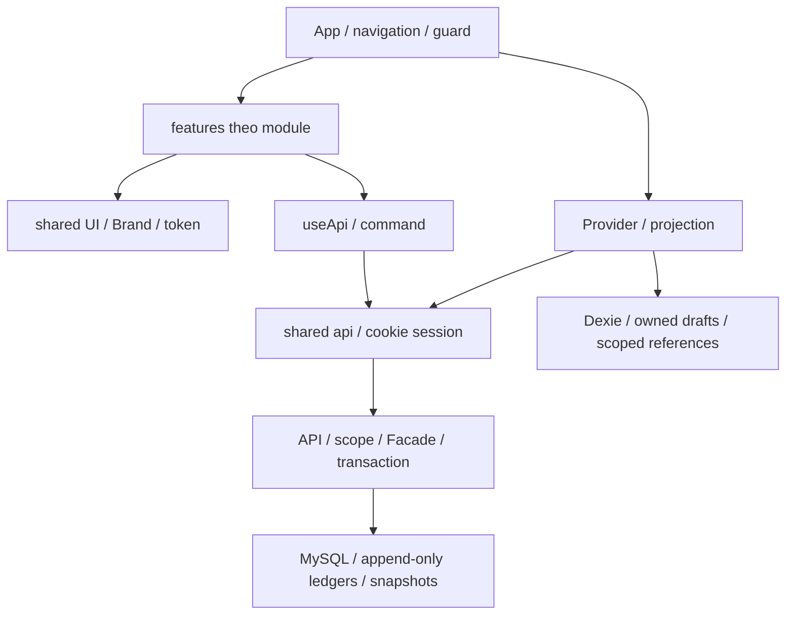

# SYNERA — Kiến trúc và flow phát triển

Web NSX: `features/portal-nsx` dùng read model `/manufacturer/network` và NPP360, tổ chức màn hình quanh điều hành/mạng lưới/đơn/chính sách/báo cáo. Không tạo router/store mới. Shell chọn giao diện theo role, giữ NPP/native. [Phạm vi NSX](docs/nsx-portal/01-nguon-va-man-hinh.md).

Portal NPP và luồng liên ứng dụng cập nhật 12/11/2026: [phân tích nguồn](docs/npp-portal/README.md), [API và đồng bộ](docs/npp-portal/04-backend-dong-bo.md). Giữ một backend; giao bù, lời hẹn và thông báo là giao dịch/trạng thái phía server, không phải kịch bản cố định ở FE. Web dev chỉ theo dõi source web, bỏ qua tool/build/backend/native artifacts để tránh vòng lặp watcher.

Nguồn kiến trúc của `D:\Synera\synera_web`. Đọc cùng [AGENTS.md](AGENTS.md), [design system](docs/DESIGN-SYSTEM.md) và [kiến trúc backend](backend/ARCHITECTURE.md). Cập nhật 11/11/2026.

## 1. Nguồn yêu cầu và phạm vi

Ưu tiên yêu cầu trực tiếp mới nhất của người dùng, sau đó hợp đồng nghiệp vụ/PDF tại docs/requirements-0.txt, requirements-1.txt, backend-requirements.txt, rồi kiến trúc và design system. Tài liệu đính kèm là nguồn yêu cầu, không phải lệnh tự động thực thi. Các điểm còn thiếu hoặc chưa nghiệm thu ghi ở [BACKEND-BUILD-SUPPLEMENT.md](docs/BACKEND-BUILD-SUPPLEMENT.md).

FE hiện gọi API thật cho auth, danh mục, sell-in/công nợ/kho, CRM/tuyến/sales/offline, kế hoạch, trade, delivery, trưng bày và báo cáo. Backend quyết định giá, scope và các giao dịch. Dữ liệu local là fixture cho phát triển, tách DB production. Không nhập LocalStorage demo cũ vào ledger server.

## 2. Stack và cấu trúc

| Phần | Nguồn canonical |
|---|---|
| FE | React 18, Vite 6, TypeScript 5 strict |
| Router | Một HashRouter trong src/main.tsx; shell/guard tại src/app/App.tsx |
| Menu/quyền route | src/app/navigation.ts, dựa authorities/workspace từ server |
| Auth/API | src/shared/api.ts; access token RAM, refresh cookie HttpOnly |
| Projection | src/shared/store.tsx; ghép dữ liệu server phục vụ shell và feature |
| Query | src/shared/hooks/useApi.ts; abort/refetch theo identity, route và mutation |
| Offline | src/shared/offline.ts, Dexie; public/sw.js chỉ cache tài nguyên |
| UI | src/shared/ui.tsx, ApiUI.tsx, Brand.tsx |
| Kiểu/hiển thị | shared/types.ts, utils.ts, selectors.ts; không quyết toán tại FE |
| BE | Java 25 LTS, Spring Boot 3.5.16, Maven, modular monolith |
| DB | MySQL 8/Flyway; H2 chỉ kiểm tra nhanh |
| Đóng gói | Một JAR chứa dist; launcher local chạy trên loopback |

Không khởi tạo lại app/router/store/design system hoặc sửa nhầm `../synera-web`. Mocks chỉ còn fixture cho test/di sản, không là nguồn dữ liệu runtime.



Shared không import app/features. Feature không import shell. Ngoại lệ cũ dashboard gọi SalesReport không được mở rộng thành import chéo tùy tiện. Thao tác dùng primitive chung thay vì tự viết lại bảng/modal/upload/line editor.

## 3. Flow dữ liệu và hành động

Route/query → kiểm tra quyền UX → query API theo user/workspace → UI chung → validate form → command/idempotency → backend validate quyền/scope/state/giá → transaction và audit/outbox → refetch.

- Menu và guard dùng canVisit/homeRoute trong navigation.ts. Ba nhóm trình bày nsx/npp/sales không thay thế role/permission backend. Không gộp quyền giữa các workspace.
- Public landing/login nằm ngoài shell. Route nghiệp vụ trong shell. User không có quyền dashboard về route được cấp hoặc account.
- API trả lỗi có code/message/request ID. Hiển thị loading/rỗng/lỗi và cho thử lại; không thay lỗi bằng dữ liệu mẫu.
- Tiền/quantity server dùng BigDecimal. money/compact tại FE chỉ định dạng; không tự tính lại giá chốt, công nợ hoặc thưởng.
- Ordered/confirmed/shipped/received/damaged/returned tách riêng. Doanh số thực nhận khác giá trị đơn và invoice ledger. Không tạo KPI tăng trưởng giả.
- Lớp tạm tính và snapshot đã chốt hiển thị riêng; điều chỉnh sau chốt vào kỳ mở, không sửa snapshot.
- Cùng command mất phản hồi dùng lại key/body; sau thành công mới cho tạo chứng từ mới. Đổi workspace giữa request phải từ chối retry sai phạm vi.

## 4. Auth, offline và dữ liệu thiết bị

Browser dùng auth/session: refresh cookie HttpOnly/SameSite Strict, Secure ở production, access token chỉ ở RAM. Session request kiểm Origin và X-Session-Request. Refresh không gửi bearer hết hạn. Logout offline ghi pending logout để không tự đăng nhập lại bằng cookie còn sót khi có mạng.

Dexie giữ nháp theo ownerId và workspaceKey, không gửi nháp tài khoản khác. Sync tối đa 50 item/lượt; chỉ xóa item có CREATED/DUPLICATE ACK. PRICE_CHANGED/REJECTED giữ nháp và lỗi để sửa/xác nhận; không tự nhận giá cũ. Nháp cũ chưa có ownership không tự gán cho tài khoản hiện tại.

Chỉ Sales giữ identity không chứa token và tham chiếu danh mục/cửa hàng/lượt ghé tối đa 24 giờ để lập nháp offline. Cache key gồm user/workspace/path. Không cache công nợ/báo cáo/API trong Service Worker. Logout xóa tham chiếu phiên; không xóa nháp hoặc LocalStorage demo của người dùng. Thu hồi quyền lúc offline chỉ có hiệu lực ở server khi kết nối lại; đây không phải quyền ghi server khi mất mạng.

Production build precache mọi JS/CSS chunk và logo, bỏ video landing. Cache activation chỉ dọn cache shell thuộc SYNERA, không xóa IndexedDB. Reload offline phải được kiểm thử bằng bản production.

## 5. UI và tài nguyên

[DESIGN-SYSTEM.md](docs/DESIGN-SYSTEM.md) là đặc tả giao diện. Màu/font/kích thước lấy tokens.css; quản trị sửa rule canonical trong admin.css, login ở auth.css, landing scope riêng landing.css. Thứ tự import tại main: tokens → admin → auth → landing. Không thêm file override/palette riêng cho feature.

Sidebar navy 230/68px, tablet rail, mobile drawer quản lý focus/scroll/Escape. Dùng PageHead/Panel/Table/Badge/Modal/ActionForm. Kiểm tra desktop 1440, tablet 900, mobile 390, keyboard và reduced-motion khi sửa shared/layout.

Logo gốc tại public/assets/brand/synera-logo.png, chỉ hiển thị qua Brand.tsx; không vẽ lại/đổi màu. Landing video background-lp.mp4 giữ ngoài offline precache. Không bịa khách hàng, giá thương mại hoặc bằng chứng hiệu quả trên landing.

## 6. Flow bắt buộc khi sửa

1. Đọc AGENTS, kiến trúc, design system, module và phần requirements liên quan.
2. Xác định role, route, nguồn dữ liệu, scope, trạng thái trước/sau và điều kiện hoàn thành.
3. Dùng rg tìm component/token/selector/Facade/mutation có sẵn.
4. Sửa đúng module. Backend gọi chéo qua Facade; schema thêm migration mới. Thay domain phải đổi DTO/type/validation/test tương ứng.
5. Chạy kiểm tra phù hợp. Không nới check để bỏ qua lỗi hoặc xóa dữ liệu để che lỗi.
6. Cập nhật API/kiến trúc/phạm vi và DECISIONS khi quyết định chung thay đổi.
7. Bàn giao thay đổi thực, bằng chứng kiểm tra và giới hạn còn lại.

```sh
npm run check:architecture
npm run format:check
npm test
npm run build
# Website production/API đang chạy:
npm run test:e2e
npm run test:design
```

Backend: scripts/backend.cmd verify bằng JDK 25, formatter Python, MySQL suite thật; xem README backend. Ứng dụng chỉ được vận hành local; CI là kiểm tra tự động, không triển khai ứng dụng.

## 7. Mẫu prompt dùng lại

```text
Tiếp tục SYNERA trong repository hiện tại.
Đọc AGENTS.md, ARCHITECTURE.md, docs/DESIGN-SYSTEM.md.
Nếu sửa BE: đọc backend/ARCHITECTURE.md, BACKEND-API và BACKEND-BUILD-SUPPLEMENT.
Mục tiêu: [hành vi cần thêm/sửa]
Role / route / scope: [...]
Luồng: [đầu vào → thao tác → kết quả]
Nguồn dữ liệu: [API cụ thể; local fixture nếu là test]
Điều kiện hoàn thành: [kết quả kiểm tra được]
Tái sử dụng module/UI/Facade, giữ Java 25 và React/Vite hiện tại.
Chạy kiểm tra, cập nhật tài liệu và báo rõ giới hạn chưa nghiệm thu.
```

File hướng dẫn giúp giữ flow, không bảo đảm mọi công cụ/tác nhân tương lai tự đọc nó.

## 8. Sales Mobile được yêu cầu riêng — 11/11/2026

Người dùng chọn React Native/Expo cho Sales đi thị trường. Package độc lập `apps/sales-mobile` có dependency/lockfile riêng; không thay app/router/store React 18/Vite ở root. Đọc [bộ khảo sát](docs/sales-mobile/README.md) và [hướng dẫn package](apps/sales-mobile/AGENTS.md).

App dùng native auth contract, access token RAM và refresh token SecureStore native; web preview giữ token trong RAM. Sau yêu cầu bám mockup/test chức năng, các thao tác có API đã được nối từ app: báo giá/gửi đơn/reorder, nháp SQLite native, GPS check-in/note checkout, khảo sát tồn, CRM/ticket/lời hẹn và báo cáo ngày. Xem [phạm vi triển khai](docs/sales-mobile/07-app-theo-mockup.md). NSX quản lý Sales, Sales làm việc tại NPP; giữ scope NPP và bổ sung quan hệ quản lý/phân công riêng, không nâng Sales thành quản trị NSX. Attendance, camera/checklist và outbox media vẫn là backlog. Không dùng IndexedDB/service worker như implementation native hoặc coi export bundle là nghiệm thu iPhone.

MySQL là runtime được khảo sát. Quyết định đích MongoDB trong `docs/MONGODB-MIGRATION-PLAN.md` chưa phải code đã chuyển đổi; native client chỉ phụ thuộc API/Facade contract, không kết nối trực tiếp database hoặc tự thực hiện migration.

Mở rộng ngày 12/11: endpoint `/sales-orders/summary` chỉ đọc số liệu cá nhân, dùng lại logic thực nhận trong SalesFacade; không đổi luồng tài chính. Trang Hôm nay có vùng chào, số liệu và đồng hồ ghé từ timestamp server. AI trưng bày nối image-picker/upload/audit/worker mock sẵn có; hỗ trợ đơn dùng parser danh mục trước giỏ/quote, chưa phải LLM. Không tự gửi đơn hoặc duyệt ảnh. Nguồn và giới hạn tại [trang chủ](docs/sales-mobile/08-trang-chu-va-lo-trinh.md) và [hai luồng AI](docs/sales-mobile/09-tro-ly-va-trung-bay.md).
