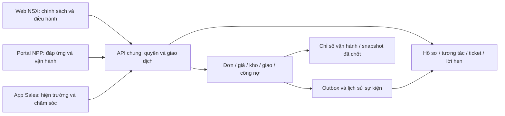

# Luồng hệ thống và FE trên nền backend

Định hướng và khoảng thiếu ở thời điểm khảo sát. Chi tiết contract đã bổ sung để hiện thực hóa luồng được ghi tại [04](04-backend-dong-bo.md).

## Nền hệ thống

Giữ modular monolith Java 25/Spring Boot/MySQL; web React 18/Vite và Sales Expo cùng gọi API. Không tách ba backend, sao chép ledger hoặc đưa quy tắc giữ tồn/duyệt xuống FE. Nếu đổi contract, ưu tiên thêm trường và giữ app Sales bản IPA đang có tương thích.

Các kịch bản chỉ là ca nghiệm thu cho backend và FE. Không đưa bản sao số liệu/tên trong kịch bản vào màn hình trình diễn.

## Ba luồng cần hoàn thiện trước

### Đặt nhập và nhận hàng

Chọn sản phẩm/đơn vị → quote server → rà giỏ → gửi sell-in → NSX kiểm/duyệt → xác nhận → xuất/giao → NPP nhập thực nhận/thiếu/hỏng → đối chiếu/ngoại lệ.

- Nháp chưa là hàng đang về đã cam kết; đã xuất chưa là NPP đã nhận đủ.
- Đặt lại lấy dòng hàng cũ làm dữ liệu đầu vào; quote lại điều kiện hiện hành.
- Nhận lệch phải có lý do/chứng từ, người xác nhận; không tự sửa invoice hoặc ledger.
- API: `/catalog/offerings`, `/pricing/quote`, `/sell-in-orders`, transition/receipt theo controller, `/returns`, `/credit` theo quyền.

### Đáp ứng sell-out và giao thiếu

Sales gửi đơn → NPP thấy đơn → kiểm lượng đáp ứng → reserve khi confirm → ship mới giảm on-hand → dispatch → ghi thực nhận → tạo ticket khi thiếu → NPP xử lý + Sales báo khách → kiểm kết quả cả hai nghĩa vụ.

Ví dụ: đặt 10, xác nhận 10, xuất 10, nhận 8. Còn thiếu 2 là nghĩa vụ gắn đơn/dòng gốc. Chỉ chuyển sang đã xử lý khi có kết quả hợp lệ; tạo đơn bán 2 thùng mới có thu tiền không phải giao bù.

- API thực: `/sales-orders`, `/delivery-trips`, `/tickets`, `/tasks`, `/appointments`, `/stores/{id}/360`.
- Contract giao bù và hạn báo khách đã bổ sung tại [04](04-backend-dong-bo.md). Thời hạn giao cam kết trên đơn gốc và các phương án điều chỉnh tài chính khác còn trong backlog.
- Trạng thái đơn, chuyến giao, ticket và lời hẹn hiển thị độc lập; không gom thành một badge “Hoàn tất”.

### Gợi ý nhập theo dữ liệu

Tồn vật lý + giữ hàng + sell-out đã thực giao + hàng dự kiến → tính lượng bổ sung → người NPP chọn → nhập nháp → quote → gửi. Không tự mua theo gợi ý.

API hiện có `/demand/replenishment` dùng tốc độ bán trong kỳ, số ngày phủ, khả dụng và hàng dự kiến; cần hiển thị kỳ/nguồn. Đề xuất nên điền SKU/đơn vị/qty vào giỏ rồi người dùng rà lại, không mang giá cũ sang.

## Cấu trúc portal đề xuất

| Màn | Nội dung/giá trị cần thấy trước | Hành động chính |
|---|---|---|
| Tổng quan | Đơn chờ NPP, hàng cần nhận, giao thiếu, việc gần hạn; số trong đúng scope | Mở hàng đợi cụ thể và chứng từ liên quan |
| Đặt hàng NSX | Tìm/nhóm sản phẩm, ảnh, đơn vị/quy đổi, giá áp dụng; giỏ luôn thấy | Tăng/giảm/nhập lượng, loại dòng, rà điều kiện, gửi |
| Đơn nhập | NSX, trạng thái, ngày, lượng ở từng mốc | Đặt lại, bổ sung, xác nhận nhận/báo lệch |
| Đơn bán | Điểm bán, Sales tạo, trạng thái đáp ứng/giao/ngoại lệ | Xác nhận lượng, xuất/giao/thực nhận theo quyền |
| Kho và nhập bổ sung | Ảnh SKU, kho/lô/HSD, vật lý/giữ/khả dụng, nguồn/lúc cập nhật | Xem phát sinh, kiểm/chuyển kho, mở kế hoạch nhập |
| Giao nhận | Chuyến và điểm giao, người phụ trách, lịch, kết quả từng lượt | Soạn/điều phối/ghi nhận, mở phần thiếu |
| Khách hàng | Tên/đầu mối/địa chỉ, người phục vụ, đơn/ticket/lời hẹn | Mở 360°, ghi phối hợp, tiếp tục việc |
| Công nợ/đối chiếu | Phải trả NSX khác phải thu điểm bán; dữ liệu không có thì không tự suy | Mở chứng từ, đối chiếu, trả hàng theo quyền |
| Chính sách và hỗ trợ | Điều kiện đang hiệu lực, đề nghị, người nhận và hạn | Tra cứu/gửi/bổ sung yêu cầu |
| Báo cáo | Sell-in, sell-out thực nhận, snapshot kỳ, truy xuống nguồn | Lọc, mở hàng đợi/chứng từ, xuất theo quyền |

Ẩn tác vụ ngoài vai bằng quyền, backend vẫn kiểm lại. Nhóm menu theo đặt nhập, bán/giao, quản lý; không trộn chức năng nhân sự NSX vào NPP.

## Quy tắc FE

- Trắng và xám trung tính cho canvas; navy cho sidebar; xanh đậm/nhạt cho header, vùng hành động và nhấn số liệu. Màu semantic chỉ báo trạng thái, không mỗi bảng một palette.
- Khung có bóng mềm vừa đủ, tiêu đề và khoảng cách rõ; hạn chế card nhỏ bao quanh từng số. Số tiền căn phải/tabular, mã/ngày cột gọn, khách/sản phẩm dành phần rộng.
- Danh sách mật độ vừa, tìm/lọc ở đầu, số lượng đúng theo tập dữ liệu lọc; lưu bộ lọc vào URL khi cần mở từ dashboard.
- Chi tiết đơn tách khỏi danh sách bằng vùng nền/tiêu đề rõ; lượng đặt/xác nhận/xuất/nhận theo cùng thứ tự trên ba giao diện.
- Chọn hàng theo ngữ cảnh B2B: ảnh SKU có thật, quy đổi và bội số cạnh lượng; giỏ cố định trên desktop, co xuống mobile; không bắt qua nhiều màn nếu chưa cần.
- Motion có mục đích: feedback thêm giỏ, chuyển tab/chi tiết, trạng thái công việc. Dùng 160–240ms và `prefers-reduced-motion`; số đang đọc không chạy sáng nhấp nháy hoặc đổi giá khi chưa báo xong.
- React Bits/21st.dev là tham khảo hành vi, không bê hiệu ứng shader/landing vào bảng nghiệp vụ. Kiểm license và dependencies trước khi lấy code; ưu tiên CSS và thư viện đã có.
- Đủ loading/error/empty, retry không tạo trùng đơn, label input, focus/keyboard, responsive; không che lỗi API bằng số minh họa.

Tham khảo đã đọc: [KiotViet nhập hàng](https://www.kiotviet.vn/huong-dan-su-dung-kiotviet/retail-giao-dich/nhap-hang/) cho thao tác tìm/chọn/lượng; [Sapo chi tiết nhập hàng](https://help.sapo.vn/xem-va-sua-don-nhap-hang-tren-sapo-omni) cho thông tin đơn/chứng từ; [Sapo kho](https://help.sapo.vn/quan-ly-kho-san-pham-tren-phan-mem-quan-ly-ban-hang-sapo) cho khả dụng/tồn; [React Bits Animated Content](https://reactbits.dev/animations/animated-content) và [21st tabs](https://21st.dev/community/components/explore/react-tabs) cho chuyển cảnh. Không sao cơ chế sửa giá/công nợ của sản phẩm khác vào SYNERA.

## Cửa nghiệm thu

1. NPP chỉ thấy dữ liệu mình; Sales không có quyền quản trị NSX/NPP; người khác scope bị chặn cả API và UI.
2. Đặt sell-in và đặt lại luôn lấy giá hiện hành; mất phản hồi/gửi lại không nhân đôi.
3. 10/10/10/8 hiện rõ 2 thiếu, người NPP xử lý và người Sales báo lại; hoàn tất một việc không xóa việc còn lại.
4. Hai đơn cùng tồn không over-reserve; quay lại/hủy không tăng/giảm kho sai.
5. Thu tiền/hoàn/giao bù không tự sửa kỳ cũ hoặc thu tiền lần hai.
6. Dữ liệu kiểm thử có phạm vi/nguồn rõ ràng; không có nút reset sổ kho, báo cáo hoặc dữ liệu của người dùng.
7. Desktop/mobile, bàn phím/giảm chuyển động, lỗi mạng/không dữ liệu đều dùng được.
