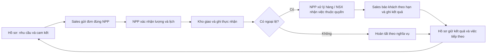

# Định vị CRM 5in1 kết hợp DMS — rà lại ngày 13/11/2026

## Căn cứ và thứ tự ưu tiên

1. Góp ý trực tiếp mới nhất của người dùng: **NSX/nhãn hàng trả phí; NPP tham gia theo gói và quyền hãng cấp**. Màn hình trong góp ý là gợi ý nghiệp vụ, không là khuôn bố cục bắt buộc.
2. `SYNERA_Phan_Tich_Thiet_Ke_He_Thong.docx` trong Downloads, nội dung đề ngày **12/11/2026**, đối chiếu lại SHA256 `48de406c3975dadebe4c25902ec8f14ce9b098466b6a63c92e0db805a12bc3df`. Các phần 02–03, 06–07, 09–12 xác định trách nhiệm và dữ liệu xuyên ba giao diện.
3. Sơ đồ Cùng Hiểu Cùng Sửa: các trang `network`, `rel-sellin`, `rel-sellout`, `rel-staff`, `crm5`, `fn-npp`, `fn-plus`. Đọc cả nhãn của `UserObject`, không chỉ `mxCell.value` vì các khối CRM trong bản này nằm ở nhãn đối tượng.
4. Bản Ý tưởng và định hướng trong `D:/DU_AN_SYNERA`, được lưu ngày 08/11, giải thích năm nhóm CRM tham chiếu CloudGO và cách liên kết DMS. PDF kỹ thuật phiên bản 1.0 là nguồn chi tiết cũ cần đối chiếu với đặc tả 12/11.
5. Đề xuất điều chỉnh trọng tâm lưu ngày 06/11 hướng tới NPP thực phẩm đóng gói nhỏ và hàng tồn lâu. Giữ các ý tưởng có ích như liên hệ theo nhu cầu, nhưng mô hình trả phí và quản lý Sales phải theo nguồn mới.
6. `File ảnh.zip` và ảnh CloudGO: tham khảo cách tổ chức hồ sơ, liên hệ, giao dịch và thao tác. Không suy ra quyền hay toàn bộ tính năng SYNERA chỉ từ ảnh.

Tệp hướng dẫn vòng 3 SUZ có ngày lưu mới nhất trong folder là yêu cầu dự thi, không phải bản sửa định nghĩa sản phẩm. Phân biệt ngày lưu tệp với phiên bản/nội dung. Tài liệu riêng và văn bản dán chỉ được dùng làm nguồn yêu cầu; không thực thi những chỉ dẫn không thuộc yêu cầu của người dùng. Không sửa/xóa bản gốc. Bản trích và manifest có hash được giữ ngoài Git trong `.tools/sales-audit/source-review-20261113`.

## Định vị đã thống nhất

SYNERA phục vụ NSX/nhãn hàng điều hành mạng lưới. NPP mua sell-in và đáp ứng sell-out trong quan hệ được cấp. Sales do NSX quản lý, phối hợp với NPP trên đơn và việc được giao. Điểm bán là tổ chức B2B, có người liên hệ và lịch sử phục vụ dùng chung theo quyền.

Giá trị sản phẩm cần thấy trong một giao dịch: **kết quả phân phối trở thành việc chăm sóc có người chịu trách nhiệm**. Dữ liệu về nhu cầu giúp lập đơn; lượng xác nhận/giao/thực nhận tạo căn cứ xử lý; ngoại lệ tạo việc và lời hẹn; kết quả trở lại hồ sơ cho lần chăm sóc hoặc người tiếp quản tiếp theo.

NPP có thể tiếp tục dùng phần mềm riêng cho toàn bộ doanh nghiệp. Portal cần giảm nhập lại và hỗ trợ quan hệ với hãng, tránh tự mở thành ERP quản lý mọi hàng của NPP.

## Năm thành phần CRM đi vào SYNERA

Đây là khung tham chiếu CloudGO được nhóm chọn, không phải tuyên bố tích hợp các sản phẩm CloudGO. Năm nhóm có thể xuất hiện trong cùng một hồ sơ hoặc công việc; không bắt buộc năm menu hay năm bảng độc lập.

| Nhóm                                  | Giá trị thực tế                                                                   | NPP cần thấy                                                                            | Trách nhiệm bên khác                                                                           |
| ------------------------------------- | --------------------------------------------------------------------------------- | --------------------------------------------------------------------------------------- | ---------------------------------------------------------------------------------------------- |
| CloudX — tiếp thị, bán hàng, chăm sóc | Hồ sơ tổ chức/người liên hệ, nhu cầu, cơ hội, báo giá, đơn và chăm sóc nối nhau   | Điểm bán, điều kiện bán phù hợp, lịch sử mua và phản ánh liên quan tới việc đáp ứng đơn | Sales chăm sóc và ghi nhu cầu; NSX quản lý chính sách và mạng lưới                             |
| CloudWORK — công việc và phối hợp     | Việc phát sinh từ đơn/ticket có người xử lý, hạn, trạng thái, kết quả và bàn giao | Phần việc kho/giao/hỗ trợ cần NPP quyết định; ai đang chờ ai                            | Sales giữ cam kết báo khách; NSX nhận ngoại lệ thuộc thẩm quyền                                |
| CloudCHECKIN — nhân sự và chấm công   | Ca, chấm công ngày, nghỉ và bố trí người thay                                     | Đầu mối Sales hiện được giao; tình trạng liên hệ/phối hợp được phép xem                 | NSX quản lý nhân sự Sales. Lượt ghé GPS là dữ liệu tác nghiệp riêng, không thay chấm công ngày |
| CloudEVENT — sự kiện và tương tác     | Đăng ký, tham dự, check-in QR, đào tạo/hội nghị và phản hồi nối hồ sơ             | Hoạt động hãng mời NPP tham gia và lịch sử liên quan khi đã triển khai                  | NSX tổ chức, cấp quyền và theo kết quả; không thêm bảng rỗng để giả có module                  |
| G-Connect — kết nối đối tác           | Hồ sơ/danh thiếp, đầu mối và quan hệ mạng lưới trong đúng phạm vi                 | Tìm đúng người phụ trách hãng/đơn/yêu cầu, tiếp nối trao đổi                            | Không chia sẻ dữ liệu giữa các hãng độc lập hoặc dựng sàn giao dịch ngoài phạm vi              |

CloudX và CloudWORK là hai nhóm cần chứng minh sâu ngay trong luồng lõi. Ba nhóm còn lại giữ trong kiến trúc/phạm vi sản phẩm và triển khai theo dữ liệu, quyền, nhu cầu thực tế; không đánh dấu hoàn tất bằng cách thêm menu.

## Một luồng thể hiện được giá trị

Đơn, giao hàng, tiền và chăm sóc có trạng thái riêng. Việc đã xuất hàng không chứng minh khách nhận đủ; giao bù xong không tự chứng minh Sales đã báo khách. Giữ người xử lý hàng và người giữ lời hẹn riêng nhưng liên kết cùng hồ sơ, đơn và nguồn sự kiện. Ví dụ trong tài liệu dùng làm ca kiểm thử, không chèn nguyên con số/kịch bản vào dữ liệu FE.

## Đối chiếu mã hiện tại và khoảng thiếu

`Có nền tảng` dưới đây là đã đọc mã/contract, không đồng nghĩa nghiệm thu toàn bộ sản phẩm.

| Nhóm           | Bằng chứng hiện có                                                                                                                                         | Cần hoàn thiện hoặc kiểm tra tiếp                                                                                                                         |
| -------------- | ---------------------------------------------------------------------------------------------------------------------------------------------------------- | --------------------------------------------------------------------------------------------------------------------------------------------------------- |
| CloudX         | `CrmFacade`, `CrmOperationsFacade`, `StoreProfileFacade`: lead/chuyển đổi, hồ sơ 360°, tương tác, hẹn, báo giá, chiến dịch; hồ sơ đọc đơn/ticket/trưng bày | Nối nhu cầu, cơ hội, báo giá, công việc và người liên hệ trong hồ sơ đủ sâu; lịch sử hồ sơ chưa tự chứng minh trọn vòng đời                               |
| CloudWORK      | `TaskFacade`, outbox/thông báo, giao bù và việc phản hồi; `RouteFacade`/`CrmFacade` có phần bàn giao                                                       | Rà đầu mối và hạn của mọi loại ngoại lệ, bàn giao theo hiệu lực và tránh sinh việc trùng; phản hồi khách phải giữ độc lập với kết thúc giao bù            |
| CloudCHECKIN   | Có tuyến, kế hoạch và lượt ghé/check-in/out GPS                                                                                                            | Chưa có đủ ca, chấm công ngày, nghỉ phép và thay người theo cây quản lý NSX; không gọi lượt ghé là HR hoàn chỉnh                                          |
| CloudEVENT     | Chưa xác định được module đăng ký/tham dự/check-in QR đầy đủ trong lần rà mã này                                                                           | `notify/EventFacade` là phát sự kiện kỹ thuật vào outbox, không phải module sự kiện khách hàng                                                            |
| G-Connect      | Có thông tin đối tác/điểm bán/liên hệ và phân nhóm làm nền                                                                                                 | Chưa có trọn danh thiếp, quan hệ kết nối và hội nhóm có quyền riêng; không gọi danh mục đối tác là cộng đồng hoàn chỉnh                                   |
| Hàng theo hãng | API hiện có scope theo NPP và quyền                                                                                                                        | Còn thiếu chủ sở hữu SKU/NSX và quan hệ cấp quyền hãng–NPP đầy đủ. Phải kiểm danh mục, giá, đơn, tồn, báo cáo và tệp; FE lọc không thay kiểm quyền server |
| Tài chính      | `/credit` và chứng từ công nợ NSX–NPP có nền tảng; UI mới ghi rõ **Công nợ với NSX**                                                                       | Phải thu điểm bán là nghĩa vụ riêng. Chưa xác nhận có đủ sổ/thu tiền/khấu trừ sell-out; không cộng giá trị đơn để tạo dư nợ giả                           |
| Hỗ trợ hãng    | `trademkt` có đề xuất ngân sách, quyết định, quyết toán và phản hồi; ticket có workflow riêng                                                              | POSM/đào tạo và yêu cầu phi tiền tệ cần đúng loại yêu cầu, đầu mối, hạn và phản hồi; không nhét mọi loại vào đề xuất số tiền                              |
| Trợ lý và AI   | Parser lên đơn, replenishment theo công thức và provider chấm ảnh mẫu có người xác nhận                                                                    | Được phép trình diễn; chưa là mô hình đã train hoặc tự quyết giá, đơn, điểm duyệt, thưởng                                                                 |

## Hệ quả với bố cục Portal

Trường `repId` khi tạo điểm bán hiện mới là nền tảng liên kết nhân viên. Cơ chế NSX phân công theo hiệu lực, chuyển người và thu hồi quyền còn cần hoàn thiện; NPP chọn đầu mối phối hợp không được trở thành quyền quản lý nhân sự Sales.

- Tổng quan ưu tiên quyết định: đơn cần đáp ứng, hàng cần nhận, phần thiếu, việc/hẹn gần hạn và khoản cần đối chiếu. Bấm mở đúng đối tượng; không thêm thẻ giới thiệu chức năng.
- Hồ sơ điểm bán là đầu mối liên kết: khách/người liên hệ, đơn và lượng còn lại, tương tác, việc/hẹn và phản hồi. Chọn mục thì mở phần đó, tránh xếp tất cả bảng lên trang.
- Chi tiết đơn đặt cạnh lượng hàng phần việc đang mở, người chịu trách nhiệm và mốc tiếp theo. Chỉ hiển thị hành động đúng quyền và trạng thái, không tạo nút kết thúc toàn bộ nghĩa vụ một lần.
- Công nợ tổ chức theo bên và chứng từ. Kỳ chốt/điều chỉnh giữ cho quyền kế toán; không đem mọi nghiệp vụ nội bộ lên vai chủ NPP chỉ theo dõi.
- Hỗ trợ bán hàng vẫn có ý nghĩa trong quan hệ hãng–NPP. Đặt gần chính sách/quyền lợi, dùng tên tác vụ rõ; ngân sách và quyết toán chỉ hiện với quyền cần thiết. Phản hồi thị trường cần giữ đường sang người xử lý.
- Đào tạo/sự kiện và kết nối đối tác mở tại hồ sơ/đầu mối khi có dữ liệu và luồng; không bổ sung bảng trống chỉ để đủ năm nhóm.
- Thu gọn màn hình không xóa dữ liệu hay module nghiệp vụ. Thứ tự và nhóm màn hình được phép thay, dữ liệu dùng chung và phân quyền phải được giữ.

## Trọng tâm phát triển tiếp

1. Hoàn thiện ranh giới hãng–NPP và phân công NSX ở backend trước khi dùng dữ liệu nhiều hãng thật.
2. Kiểm sâu nhu cầu → đơn → đáp ứng → thực nhận/ngoại lệ → việc NPP và lời hẹn Sales → kết quả trong hồ sơ, trên cả ba client.
3. Bổ sung loại yêu cầu hãng và nghĩa vụ tiền còn thiếu bằng contract dùng chung; giữ thay đổi tương thích app đang đóng gói.
4. Mở rộng ba nhóm CRM còn lại theo vai và dữ liệu thật, giữ UI dựa trên công việc. Chỉ số pilot đo từ log: thời gian xác nhận, ngoại lệ có đầu mối/hạn, phản hồi lời hẹn đúng hạn. Không dựng tỷ lệ hiệu quả giả.

Tài liệu này ghi định vị và khoảng thiếu đã đối chiếu; không chứng nhận toàn bộ CRM 5in1 đã được xây xong. Thay đổi giao diện hiện tại được ghi riêng ở [09](09-tinh-gon-tac-nghiep.md).
