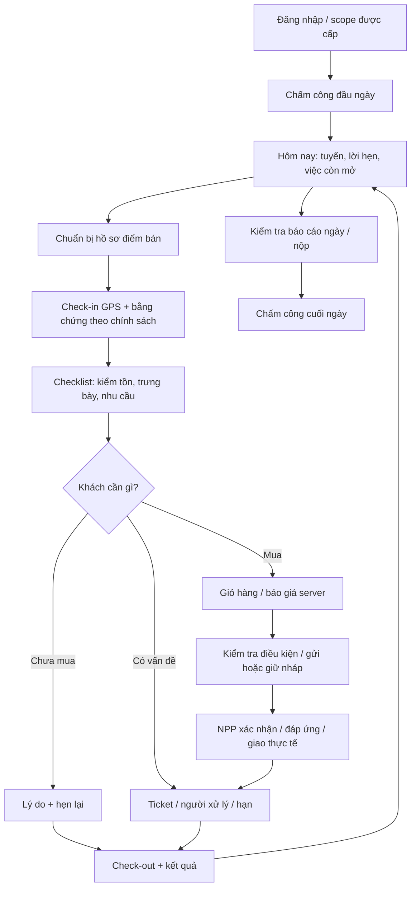

# Luồng tác nghiệp và thành phần màn hình

## Một ngày của Sales

Sơ đồ là đích thiết kế, không phải các chức năng đều đã có trong bộ khung. Bước chấm công/checklist/bằng chứng/native outbox còn nằm trong backlog. Không ép Sales tạo đơn để kết thúc lượt ghé; khách chưa mua vẫn là kết quả cần lưu. Hàng còn nhiều, khách nghỉ, điểm đóng cửa, địa chỉ sai và đang chờ bù phải có đường đi riêng.

## Liên hệ các bên

| Bên | Dữ liệu / quyết định | Sales làm gì trên app |
|---|---|---|
| NSX / quản lý vùng | Nhân sự, tuyến, MCP, tiêu chí, sản phẩm/chính sách và KPI của NSX | Nhận lịch, xem chính sách, thực hiện công việc và báo kết quả; không tự mở scope |
| NPP / kho / điều phối | Khả năng đáp ứng, lượng xác nhận, lịch giao, lượng xuất/giao/nhận | Gửi nhu cầu/đơn và theo dõi; nhận việc báo lại khách khi thay đổi |
| Điểm bán / người liên hệ | Nhu cầu, quan sát tồn có xác nhận, giờ nhận, lý do chưa mua, thiếu/hỏng | Ghi đúng ngữ cảnh, phân biệt người liên hệ và tổ chức, giữ lời hẹn |
| Admin/CS/quản lý xử lý | Phân công ticket, hạn, phản hồi và phương án | Theo dõi vụ việc, bổ sung bằng chứng, báo kết quả; không tự sửa nợ hoặc đóng việc thay bộ phận khác |
| Sales đi thay | Tuyến và việc đang dở trong khoảng thời gian được giao | Nhận bàn giao, nhìn lịch sử phù hợp, giữ tác giả/thời gian của người trước |
| Người giao hàng | Chứng từ chuyến, xác nhận thực giao/nhận theo quyền | Sales nhìn tiến độ liên quan; không mặc định là tài xế hay được xuất kho |

NSX quản lý Sales; Sales được phân công làm việc tại NPP. Quan hệ này giải thích vì sao app có ngữ cảnh NPP Minh Phát mà Sales vẫn chịu quản lý của NSX. Quyền tổ chức NSX và NPP phải tách nhau. Sales không mặc nhiên được xem toàn bộ hàng đối thủ, sổ công nợ hoặc dữ liệu nhân sự NPP; NPP cũng không mặc nhiên xem chấm công toàn đội NSX. Nhãn tài khoản nên thể hiện riêng “NSX quản lý” và “NPP đang làm việc” khi server đã cung cấp, không tự điền từ tên NPP.

## Điều hướng app

Bốn tab là các khu vực, không phải nút hành động: **Hôm nay · Điểm bán · Đơn hàng · Tài khoản**. Chi tiết dùng native stack và giữ Back/swipe-back. Tạo đơn, khảo sát, ticket và lời hẹn bắt đầu từ điểm/lượt ghé, không thành hàng loạt tab riêng. Badge hàng chờ gửi nằm ở Hôm nay/Đơn hàng, không là một tab gây mất ngữ cảnh.

### Hôm nay

Ngày nghiệp vụ Asia/Ho_Chi_Minh; tình trạng ca, tuyến được giao, lượt tiếp theo và việc hẹn còn mở. Danh sách thể hiện tên điểm, địa chỉ, khoảng giờ, trạng thái, nhiệm vụ; map/chỉ đường là lựa chọn, không thay toàn bộ danh sách. Tóm tắt phải tách số PLANNED/CHECKED_IN/COMPLETED và đơn gửi/đã nhận, không gộp thành một KPI mơ hồ.

Trong web khảo sát: lịch ghé là card từ bảng quản trị; trang nháp rỗng vẫn chiếm nhiều chiều cao; nhiều chức năng nằm trong drawer quản trị; có trạng thái CHECKED_IN chưa dịch. App cần ưu tiên một thao tác theo ngữ cảnh, rút gọn trạng thái rỗng và không mang 11 mục quản trị vào navigation mobile.

### Chuẩn bị ghé / hồ sơ 360°

Header tổ chức/địa chỉ và người liên hệ; lời hẹn/ticket chưa xong; lần ghé/đơn/thực nhận gần nhất; nhu cầu và ghi chú. Đơn, tương tác, hẹn, ticket và ảnh dùng các section phân trang server hiện có. Phải cho biết giới hạn lịch sử khi scope chỉ cho xem đơn của chính mình; không mô tả là toàn bộ lịch sử khách.

### Phiên ghé

Trạng thái riêng: chuẩn bị → xin quyền → lấy GPS → có/thiếu bằng chứng → đang ghé → kiểm tra điều kiện kết thúc → đã gửi hoặc chờ đồng bộ. Hiển thị độ chính xác, thời điểm lấy mẫu và lý do ngoại lệ. Người từ chối GPS/camera có hướng dẫn mở lại quyền hoặc quy trình ngoại lệ hợp lệ; không cấp toạ độ giả hay tự xác nhận ảnh.

Checklist theo phiên bản đã cấu hình: kiểm tồn, kiểm trưng bày, nhu cầu/đơn, phản ánh, hẹn lại. Không mặc định mọi cửa hàng đều phải làm mọi bước; ghi không áp dụng/không thực hiện cùng lý do khi chính sách cho phép. Không đóng lượt trên UI trước khi server ACK.

### Giỏ hàng và theo dõi đơn

SKU có ảnh, tên, đơn vị và số lượng rõ; bàn phím phù hợp; không đổi THÙNG thành CHAI chỉ bằng label. Context `storeId/visitId` giữ qua quay lại và khi bị gián đoạn. Luồng đề xuất: chọn hàng → điều kiện/giao nhận → tổng kết/gửi. Báo giá tạm tính tách giá server đã chốt. Đơn gần đây chỉ điền giỏ mới rồi kiểm giá/chính sách lại.

Danh sách Đơn hàng tách Nháp thiết bị, Chờ xác nhận giá, Đã gửi và đang thực hiện. Chi tiết hiển thị lượng đặt/xác nhận/xuất/thực nhận từng dòng, cam kết giao, phần thiếu và ticket liên quan. Giao bù không phải tạo đơn thu tiền mới. Bộ khung hiện chỉ có list/detail đọc server; không có nút gửi giả.

### Phản ánh, hẹn và yêu cầu thay đổi điểm

Một tác vụ ngắn gắn sẵn điểm/lượt ghé; ảnh được lưu chờ upload nếu chưa có mạng. Ticket có người tiếp nhận, hạn và diễn biến. Request thêm điểm/sửa toạ độ có trạng thái đang soạn/chờ duyệt/cần bổ sung/từ chối/đã áp dụng. Không tự cập nhật toạ độ chuẩn chỉ để vượt điều kiện check-in.

### Cuối ngày

Tổng hợp từ giao dịch/lượt ghé gốc, xem việc chưa gửi và khác biệt trước khi nộp. Báo cáo đã nộp không ghi đè. Chấm công kết thúc ngày là chứng từ riêng; nộp báo cáo không tự kết thúc ca và kết thúc lượt ghé không tự nộp báo cáo.

## Thành phần dùng lại

Đã chuẩn bị: screen trạng thái loading/rỗng/lỗi/thử lại, danh sách phẳng, trạng thái có nhãn, nút và ô nhập, session provider, native stack/tab, theme và brand gốc. Cần xây tiếp: `VisitContextHeader`, `PermissionPrompt`, `GPSAccuracyRow`, `VisitChecklist`, `EvidenceCapture`, `SurveyLineEditor`, `OrderCart`, `QuoteSummary`, `FulfillmentTimeline`, `TicketComposer`, `FollowUpEditor`, `DraftSyncQueue`, `AttendanceCard`, `DayReportReview`.

Mỗi thành phần tác nghiệp cần các trạng thái đang nhập/đang gửi/mất phản hồi/đã ACK/lỗi cần sửa. Thiết bị nhỏ vẫn đọc được, nút chính tối thiểu 44pt iOS, chữ hỗ trợ phóng to, không phụ thuộc hover, bàn phím không che CTA, safe area không che tab. Danh sách dài dùng FlatList và phân trang, không tải hết ảnh hoặc mọi section khi chưa mở.

Native phải được nghiệm thu trên iPhone/macOS Simulator: light/dark, Dynamic Type lớn, bàn phím, quay lại/swipe, foreground/background, offline, quyền bị thu hồi và thiết bị thật cho camera/GPS. Bằng chứng browser không được gắn nhãn native.
